# KStats+ — Advanced Kernel & Process Monitoring for xv6-RISC-V

### Operating Systems Group Project — 10 Core Modules + 10 Mini-Extensions

> **Project type:** MIT xv6-RISC-V kernel instrumentation and diagnostics  
> **Group size:** 5 students  
> **Target:** RISC-V 64-bit on QEMU  
> **Current status:** Finalized project design and implementation plan; full integrated project and regression tests **not yet verified**

## Group Members

| Member | Assigned Core Modules | Responsibility |
| :--- | :--- | :--- |
| **Haseeb** | **1. Boot-Time Profiler** and **6. Process Information Monitor** | Boot measurements, process listings and PID/state filtering |
| **Huzi** | **3. Sleep/Wakeup Activity Monitor** and **8. Process Memory Usage Monitor** | Per-process sleep statistics and virtual memory tracking |
| **Ibraheem** | **2. Process Lifecycle Monitor** and **7. CPU Time Monitor** | Process events and sampled CPU runtime |
| **Sajid** | **5. Kernel Tick & Uptime Monitor** and **10. System Call Usage Monitor** | Timers, multi-HART counts and syscall statistics |
| **Baker** | **4. Page Fault Counter** and **9. Context Switch Monitor** | Fault diagnostics and scheduler activity |

> Roll numbers have not been provided and should be added by the group before submission. Names above follow the spellings supplied by the group.

---

## 1. Project Overview

**KStats+** is a proposed observability extension for the official **MIT xv6-RISC-V** teaching kernel. Its purpose is to make important kernel operations visible to students through counters, process snapshots, event summaries and simple user-space commands **without replacing xv6's scheduler, file system, or virtual-memory policy**.

The project retains the original five **KStats** monitoring areas and expands the system to **ten core modules**. Each core module has a **specific mini-extension** that adds meaningful functionality beyond the basic counter or display.

**Scope:** 10 core monitoring modules + 10 targeted mini-extensions, integrated into **one** xv6 repository for one five-member OS group.

**Educational goals:**

- Understand process creation, exit, sleep, wakeup and scheduling.
- Observe RISC-V page faults and xv6 lazy page allocation.
- Measure process CPU activity, virtual-memory size and system-call usage.
- Learn kernel/user communication through new system-call interfaces.
- Build verifiable kernel diagnostics rather than relying only on console messages.

**What KStats+ is not:** a full performance profiler, a priority scheduler, a COW implementation, a Linux loadable kernel module, or a replacement OS. In this course, each *module* means a built-in kernel instrumentation feature/extension.

## 2. Selected Features — 10 Modules & 10 Mini-Extensions

| # | Core Module | Targeted Mini-Extension |
| -: | :--- | :--- |
| **1** | **Boot-Time Profiler** | Identify the slowest initialization stage and show measured stage-wise time percentages |
| **2** | **Process Lifecycle Monitor** | Keep a bounded PID-based creation/exit/reap event history |
| **3** | **Sleep/Wakeup Activity Monitor** | Track per-process sleep/wakeup counts and cumulative sleeping ticks |
| **4** | **Page Fault Counter** | Classify per-PID load/store faults and resolved versus failed cases |
| **5** | **Kernel Tick & Uptime Monitor** | Collect per-HART timer interrupt counts in addition to global uptime |
| **6** | **Process Information Monitor** | Support PID-filtered listings and a summary of processes by state |
| **7** | **CPU Time Monitor** | Report sampled per-process CPU ticks and approximate CPU utilization |
| **8** | **Process Memory Usage Monitor** | Track current/peak virtual memory size and growth/shrink events |
| **9** | **Context Switch Monitor** | Track per-process scheduler dispatches and the last assigned HART |
| **10** | **System Call Usage Monitor** | Show per-process syscall frequencies, most-used syscall and failures |

**Counting rule:** These are **10 core modules**, each with **one mini-extension bundle** (which may include multiple closely related output fields). This is **not** a claim that 20 unrelated kernel subsystems are being replaced.

---

## 3. Proposed System Architecture

KStats+ uses a read-only diagnostics interface: kernel hooks update statistics; user programs request snapshots and format them for the shell. The system is split into four layers.

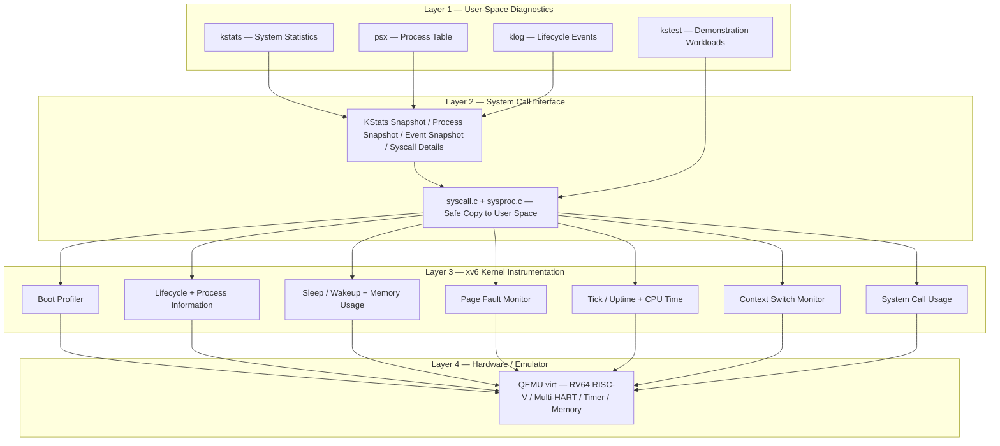

### Monitoring and Report Flow

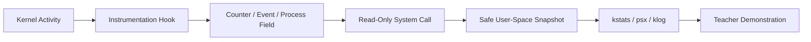

### Planned Outputs

| Command | Expected purpose | Primary modules |
| :--- | :--- | :--- |
| `kstats` | System-wide boot, process, sleep, faults, timer, dispatch, syscall summary | 1–5, 9–10 |
| `kstats boot` | Boot stages and slowest stage | 1 |
| `kstats faults` | Page-fault classification | 4 |
| `kstats cpu` | Per-HART timer data | 5 |
| `psx` | PID, PPID, name, state, CPU ticks, memory, switches | 3, 4, 6–9 |
| `psx -p PID` | Only a selected PID | 6 |
| `klog` | Recent process lifecycle events | 2 |
| `kstest` | Generate repeatable events for demonstration | All applicable modules |

**All listed KStats+ commands are proposed interfaces until implemented.** The official xv6 baseline does not provide these names by default.

---

# 4. Detailed Core Modules and Mini-Extensions

## Module 1 — Boot-Time Profiler

**Purpose:** Find how much RISC-V timer-counter time is spent initializing major xv6 kernel components during boot.

**Core functionality:**
- Record a boot-start timestamp and the total measured boot interval.
- Measure important stages: physical allocator (`kinit`), virtual memory (`kvminit` / `kvminithart`), process table (`procinit`), traps/interrupts, and storage initialization.
- Expose a read-only boot summary through `kstats boot`.

**Mini-Extension — Slowest Stage & Timing Percentage:**
- Identify the most time-consuming instrumented stage.
- Report each stage's percentage of the **sum of instrumented stages**; also report overall measured boot time separately.
- Keep raw RISC-V `time` counter units unless timer frequency is verified; do **not** label them milliseconds without conversion.

**Planned execution flow:**

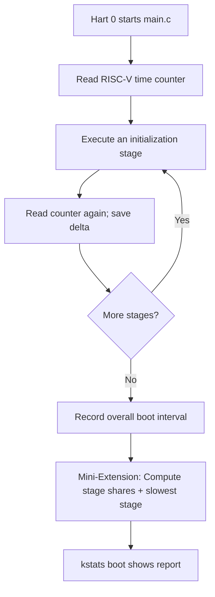

**Example output (illustrative, not measured):**

```text
$ kstats boot
BOOT PROFILER — time-counter units
Allocator         : 500
Virtual memory    : 1200
Process table     : 350
Trap / interrupts : 450
Storage init      : 1500
Slowest stage     : Storage init
Measured stages   : 4000
Total boot window : 4500
```

**Relevant kernel files:** `kernel/main.c`, `kernel/riscv.h`, new `kernel/bootprof.c`, shared statistics header.

**Validation:** Boot xv6 twice, confirm stable nonnegative stage measurements and correct maximum/percentage calculations. Small differences between boots are normal.

---

## Module 2 — Process Lifecycle Monitor

**Purpose:** Observe when processes are successfully created, enter the zombie state, and are finally cleaned up by a parent.

**Core functionality:**
- Count successful process creations, exits and reaping events.
- Distinguish process **exit** from **reap**: a zombie is not yet reaped.
- Maintain global lifetime totals even after individual `struct proc` slots are reused.

**Mini-Extension — Recent PID-Based Event History:**
- Add a bounded circular buffer of the last **64** lifecycle events (proposed capacity).
- Each event contains a PID, event type (`CREATE`, `EXIT`, `REAP`) and tick timestamp.
- Expose event history through `klog`. When full, replace the oldest record.

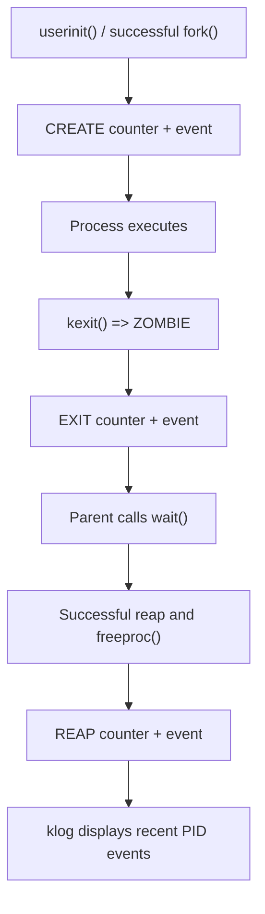

**Example output (illustrative):**

```text
$ klog
TICK   PID   EVENT
120    3     CREATE
124    3     EXIT
125    3     REAP
```

**Relevant kernel files:** `kernel/proc.c`, `kernel/proc.h`, new `kernel/proclife.c`, user event viewer.

**Validation:** Fork a child, exit normally, call `wait()`; confirm one create/exit/reap sequence and unchanged counters if a failed fork is deliberately induced. Never count unsuccessful allocation as a completed process creation.

---

## Module 3 — Sleep/Wakeup Activity Monitor

**Purpose:** Measure how often processes block and later become runnable.

**Core functionality:**
- Count actual transitions into the `SLEEPING` state.
- Count transitions from `SLEEPING` back to `RUNNABLE` through wakeup or kill-related paths.
- Report total sleep and wakeup activity system-wide.

**Mini-Extension — Per-Process Counts and Sleeping Ticks:**
- Track `sleep_count` and `wakeup_count` per process.
- Record tick when a process enters sleep, and accumulate sleeping ticks when it is woken.
- Clearly label this as **tick-granularity sleeping time**, not nanosecond-accurate latency.

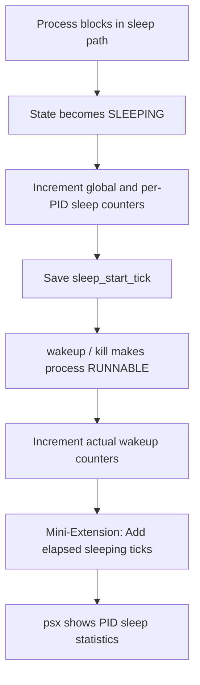

**Implementation note:** Check the **pinned** xv6 commit: some revisions use `sleep(chan, lock)`, while newer ones include `sleep_prepare()` and `sleep()` paths. Count state transitions at the implementation actually present, not by blindly pasting old snippets.

**Relevant kernel files:** `kernel/proc.c`, `kernel/proc.h`, `kernel/trap.c` (for ticks), new `kernel/sleepmon.c`.

**Validation:** Run a `pause()`-based test and confirm that per-PID counts and sleeping ticks increase. Repeated wakeup calls must not count an already runnable process as woken.

---

## Module 4 — Page Fault Counter

**Purpose:** Observe user-mode virtual-memory faults and whether xv6 resolves them.

**Core functionality:**
- Count user **load** page faults (`scause = 13`) and **store** page faults (`scause = 15`).
- Record whether the existing xv6 fault handler resolves the fault (e.g., lazy allocation) or rejects it.
- Maintain system-wide `total`, `resolved`, and `failed` counters.

**Mini-Extension — PID-Wise Fault Classification:**
- Track fault counts separately for each process and type.
- Include last fault address (`stval`) as a diagnostic field where safe and useful.
- Retain aggregate counters even after a faulting process exits.

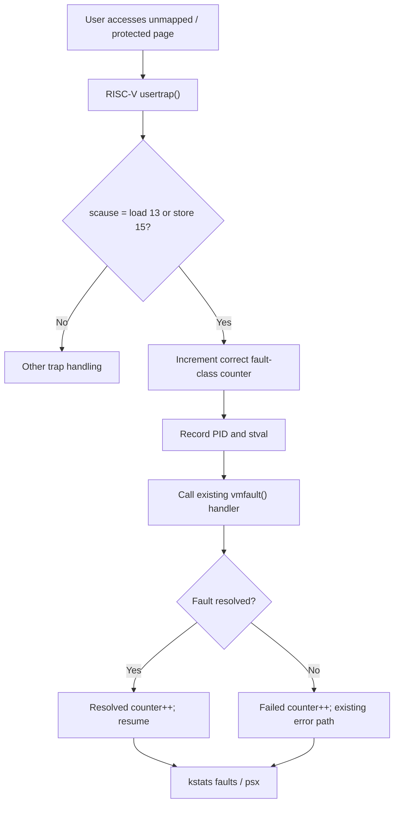

**Critical boundary:** The initial module covers user load/store faults only. An instruction page fault (`scause = 12`) is not silently included in the total. Fault resolution must preserve xv6's original behavior.

**Relevant kernel files:** `kernel/trap.c`, `kernel/vm.c`, `kernel/proc.h`, new `kernel/faultmon.c`.

**Validation:** Use a known lazy-allocation test to create a resolvable fault. Separately trigger an invalid address in a disposable child process and verify the failed count without crashing the kernel.

---

## Module 5 — Kernel Tick & Uptime Monitor

**Purpose:** Report global uptime and timer-interrupt activity in a multi-HART xv6 system.

**Core functionality:**
- Read xv6's existing global `ticks` counter under the appropriate lock.
- Count total serviced timer interrupts.
- Show uptime in **ticks**, and calculate time units only after checking the emulator's tick period.

**Mini-Extension — Timer Interrupts per HART:**
- Maintain a counter indexed by the executing HART ID.
- Display activity separately for the configured CPUs/HARTs.
- Explain that the sum of interrupts across HARTs is not equal to xv6 global uptime ticks; in the reviewed baseline, `clockintr()` increments `ticks` only on hart 0.

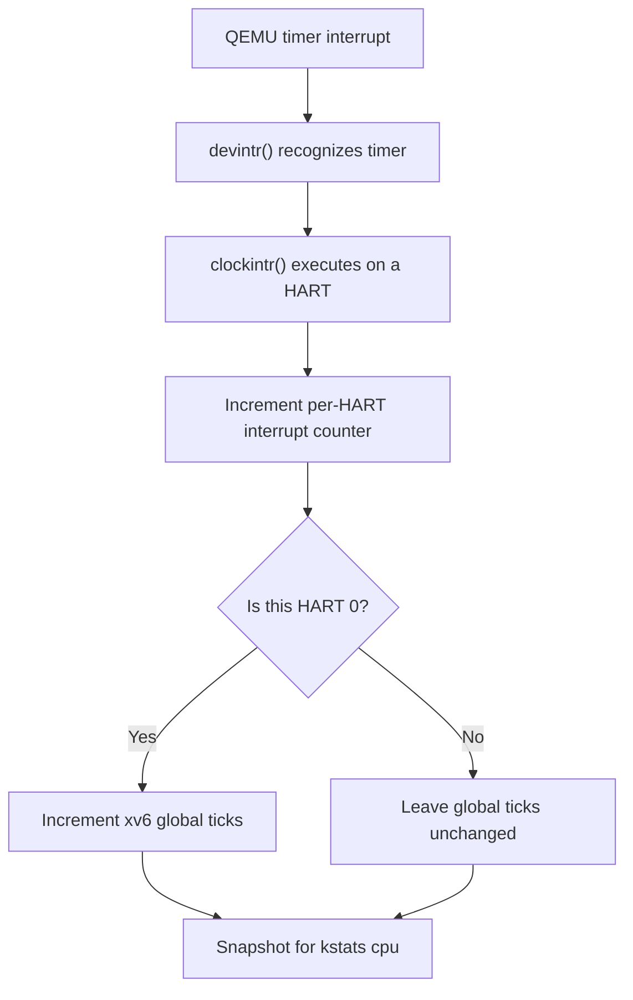

**Relevant kernel files:** `kernel/trap.c`, `kernel/proc.c` (`cpuid`), `kernel/param.h`, new `kernel/tickmon.c`.

**Validation:** Observe uptime increasing; with multiple CPUs configured, verify per-HART counters respond and that global ticks do not simply multiply by CPU count.

---

## Module 6 — Process Information Monitor

**Purpose:** Display a safe, readable snapshot of the xv6 process table.

**Core functionality:**
- For each active process, expose **PID, PPID, name and current state**.
- Use process states such as `USED`, `SLEEPING`, `RUNNABLE`, `RUNNING` and `ZOMBIE`.
- Copy data into a user-space process table for `psx` instead of repeatedly printing inside kernel traps.

**Mini-Extension — PID Filtering and State Summary:**
- Support `psx -p PID` to inspect one process.
- Count how many processes are in each state.
- Clearly separate this module from **Module 8**, which owns memory-history accounting; a memory column in `psx` is an integration output, not a duplicate module.

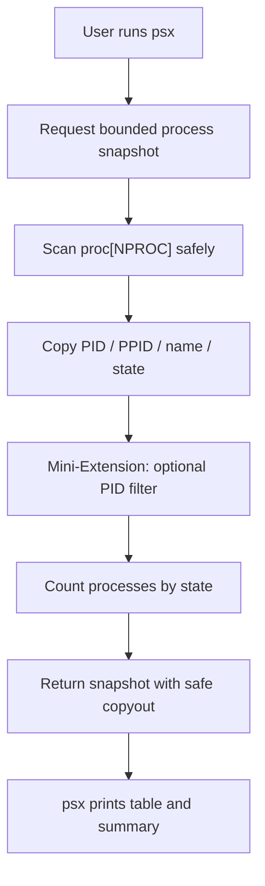

**Concurrency requirement:** Reading `p->parent` is subject to `wait_lock` rules in xv6. A snapshot implementation must respect lock ordering and avoid holding incompatible locks while calling `copyout()` or printing.

**Relevant kernel files:** `kernel/proc.h`, `kernel/proc.c`, `kernel/sysproc.c`, user `psx.c`.

**Validation:** Compare `psx` to normal xv6 `procdump` observations; create and exit children, confirm states/counts update and invalid `-p` values are handled.

---

## Module 7 — CPU Time Monitor

**Purpose:** Estimate how long each process actually executes on a CPU, as opposed to merely existing or sleeping.

**Core functionality:**
- Maintain a `cpu_ticks` counter per process.
- Increment it at an identified timer-sampling point when the process is executing; avoid double-incrementing for one interrupt.
- Show CPU ticks as **sampled runtime**; short tasks may use less than one tick and appear as zero.

**Mini-Extension — Approximate CPU Utilization:**
- Record a process start tick and calculate elapsed ticks for a consistent reporting interval.
- Compute an illustrative ratio `CPU% ≈ 100 × sampled_cpu_ticks / elapsed_ticks`, with zero-denominator protection.
- Explain that this is a **sampling approximation**, not a high-resolution wall-clock measurement.

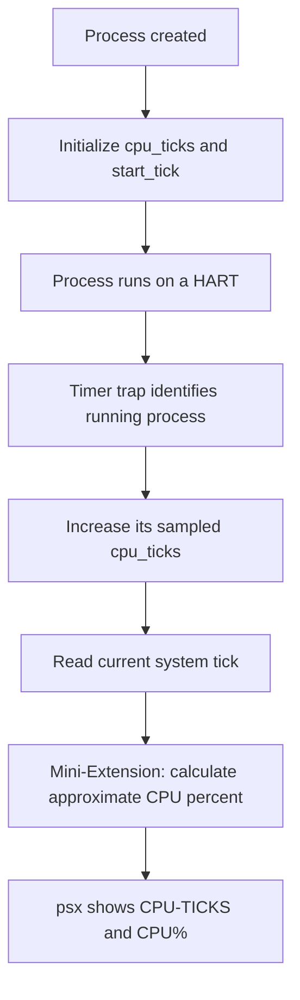

**Separation:** Module 5 counts system clock/interrupt events. Module 7 attributes sampled execution to **individual PIDs**.

**Relevant kernel files:** `kernel/proc.h`, `kernel/trap.c`, `kernel/proc.c`, user `psx.c` and CPU workload test.

**Validation:** Compare a CPU-bound workload with a sleeping process over similar elapsed time; the CPU-bound process should generally accumulate more sampled running ticks.

---

## Module 8 — Process Memory Usage Monitor

**Purpose:** Track the virtual address-space size of each process and how it changes.

**Core functionality:**
- Read `p->sz` as the current **process virtual address-space size** in bytes.
- Show KB (`size_bytes / 1024`) and track per-process size where it changes during `fork`, `exec`, `sbrk` and memory deallocation paths.
- Avoid claiming that `p->sz` equals actually resident physical RAM.

**Mini-Extension — Peak Size and Growth/Shrink History:**
- Add `peak_sz` initialized to current size and updated when memory increases.
- Count successful growth and shrink operations, or keep a last-delta field.
- Respect lazy `sbrk` paths, which may increase virtual size without immediately allocating a physical page.

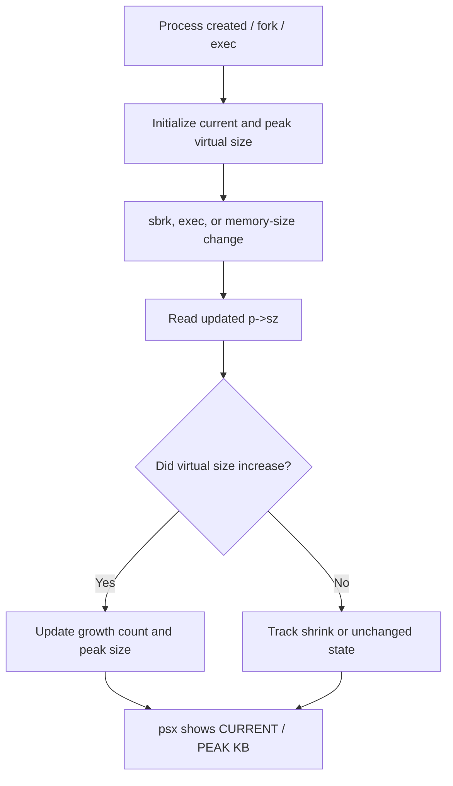

**Relevant kernel files:** `kernel/proc.h`, `kernel/proc.c`, `kernel/sysproc.c`, `kernel/exec.c` (based on the chosen xv6 revision), user memory test.

**Validation:** Allocate and free memory, verify current size and peak behavior. Run a lazy allocation test and confirm the documentation does not falsely report physically resident pages.

---

## Module 9 — Context Switch Monitor

**Purpose:** Observe how often xv6 dispatches processes through the scheduler.

**Core functionality:**
- Count **scheduler dispatches** globally and per process.
- Increment when a runnable process is chosen and scheduled to execute.
- Distinguish "scheduler dispatch count" from a hardware-measured total of all context-switch transitions.

**Mini-Extension — Last HART and Most-Dispatched Process:**
- Record the HART ID on the most recent scheduler dispatch for a process.
- Show the top process by dispatch count in a system-wide summary.
- Use process locking or appropriate atomic updates to avoid inconsistent reads in SMP mode.

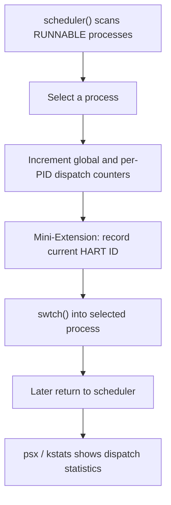

**Separation:** Module 7 measures sampled CPU execution; Module 9 counts **how often** a process is scheduled, not how long it ran.

**Relevant kernel files:** `kernel/proc.c`, `kernel/proc.h`, new context monitor helper, user `psx.c`.

**Validation:** Start several processes that frequently block or yield. Their scheduler dispatch counters should increase; the last-HART value must be valid for the configured CPU count.

---

## Module 10 — System Call Usage Monitor

**Purpose:** Measure how often processes enter xv6 system-call handlers and how those calls behave.

**Core functionality:**
- Count valid system-call invocations globally and per PID.
- Track invalid/unknown syscall attempts separately.
- Keep counts in the existing `syscall()` dispatch path without changing handler semantics.

**Mini-Extension — Per-Syscall Frequency and Failure Statistics:**
- Maintain buckets by valid system-call number for per-PID frequencies.
- Identify most frequently called syscall for a selected PID.
- Count handler-reported failures where the syscall's return convention treats a negative result as an error; document any exceptions instead of assuming every negative value is universally an error.

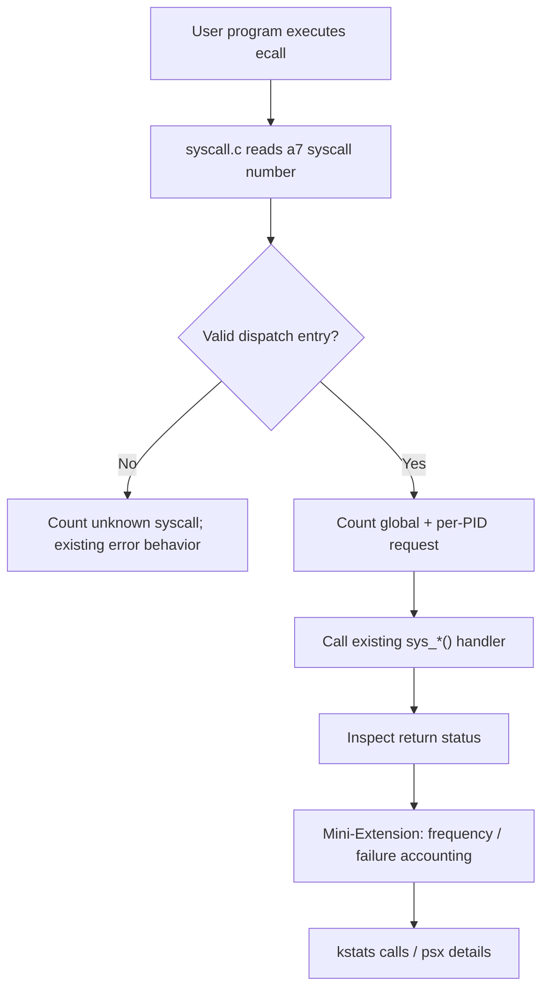

**Safety rule:** No unbounded console printing from the syscall hot path. Add counters with appropriate synchronization and return snapshots through a proper user-visible interface.

**Relevant kernel files:** `kernel/syscall.c`, `kernel/syscall.h`, `kernel/proc.h`, `kernel/sysproc.c`, user syscall viewer.

**Validation:** Repeatedly call `getpid`, `write`, `open` and an intentionally invalid operation in a disposable test program. Check per-type counts and error classification. Account for statistics-query syscalls possibly counting themselves.

---

# 5. Proposed Shared Kernel Data Design

The group should share data definitions to reduce duplicate fields and disagreements between modules. Names below are **proposed implementation interfaces**, not functions already available in stock xv6.

| Data structure | Key fields | Purpose |
| :--- | :--- | :--- |
| `kstats_global` | boot stages, created/exited/reaped, sleep/wakeup totals, faults, ticks, per-HART interrupts, dispatches, syscalls | System snapshot |
| `kstats_proc` | pid, ppid, name, state, sleep/wakeup, fault counts, cpu ticks, memory size/peak, dispatches, last HART, syscall total | One process snapshot |
| `kstats_event` | tick, pid, event type | Bounded lifecycle history |
| `kstats_syscalls` | pid, per-syscall frequency, failure counts | Detailed syscall accounting |

**Proposed C interface:**

```c
// Suggested API only; implementations and exact types are not yet finalized.
int kstats(struct kstats_global *out);
int kprocs(struct kstats_proc *out, int capacity);
int kevents(struct kstats_event *out, int capacity);
int ksyscalls(int pid, struct kstats_syscalls *out);
```

**Important integration details:**

1. Assign syscall numbers only after pinning the baseline; official reviewed `syscall.h` currently ends at `SYS_sync = 22`, but a previously modified KStats checkout may already use number 23.
2. Update `kernel/syscall.h`, `kernel/syscall.c`, `kernel/sysproc.c`, `user/user.h`, `user/usys.pl` and `Makefile` together.
3. Use `copyout` with size and buffer-capacity validation; never expose raw kernel pointers or pass kernel locks to user space.
4. Use bounded snapshots/events: the process table and event ring must not overflow user buffers.
5. Initialize per-process counters when an entry is reused; preserve completed system-wide lifetime totals separately.
6. Use per-process locks, kernel locks or atomics consistently. Avoid lock-order inversions between `wait_lock`, `p->lock`, `tickslock` and output routines.
7. Read shared counters into local snapshots before formatting; do not hold locks while printing large tables.
8. Do not add expensive tracing or kernel `printk` messages to every timer tick or system call.

## Source-Files Mapping

| Core module | Primary implementation locations |
| -: | :--- |
| 1 | `kernel/main.c`, `kernel/riscv.h`, `kernel/bootprof.c` |
| 2 | `kernel/proc.c`, `kernel/proc.h`, `kernel/proclife.c` |
| 3 | `kernel/proc.c`, `kernel/proc.h`, `kernel/sleepmon.c` |
| 4 | `kernel/trap.c`, `kernel/vm.c`, `kernel/faultmon.c` |
| 5 | `kernel/trap.c`, `kernel/tickmon.c`, `kernel/param.h` |
| 6 | `kernel/proc.c`, `kernel/proc.h`, `kernel/sysproc.c`, `user/psx.c` |
| 7 | `kernel/trap.c`, `kernel/proc.h`, `user/psx.c` |
| 8 | `kernel/proc.c`, `kernel/sysproc.c`, `kernel/exec.c`, `user/psx.c` |
| 9 | `kernel/proc.c`, `kernel/proc.h`, `user/psx.c` |
| 10 | `kernel/syscall.c`, `kernel/proc.h`, `kernel/sysproc.c` |

The `kernel/*mon.c` helpers listed above are **planned additions**. They do not exist in the unmodified MIT repository.

## Target Repository Layout (Proposed)

```text
KStatsPlus-xv6-riscv/
├── kernel/
│   ├── main.c               # Boot timing hooks
│   ├── proc.c / proc.h       # Process state, CPU and scheduling counters
│   ├── trap.c               # Fault and timer hooks
│   ├── syscall.c            # System-call accounting
│   ├── sysproc.c             # Snapshot system-call implementations
│   ├── syscall.h            # Syscall numbers
│   ├── kstats.h              # Shared snapshot structures
│   ├── bootprof.c           # Module 1
│   ├── proclife.c           # Module 2
│   ├── sleepmon.c           # Module 3
│   ├── faultmon.c           # Module 4
│   └── tickmon.c            # Module 5
├── user/
│   ├── kstats.c             # Global statistics command
│   ├── psx.c                # Process statistics viewer
│   ├── klog.c               # Lifecycle event viewer
│   ├── kstest.c             # Test workload generator
│   ├── user.h               # User system-call declarations
│   └── usys.pl              # User ecall stubs
├── tests/                   # Scripts or test notes (planned)
├── docs/
│   ├── USER_MANUAL.md       # Commands, build and test steps
│   └── RESULTS.md           # Real measured results, once tested
├── Makefile
└── README.md
```

This is the **target** combined repository structure. It is **not** a claim that these files have all been implemented or merged yet.

---

# 6. Example User-Space Output (Planned)

> All values below are **illustrative examples**, not captured QEMU execution logs.

### Overall Statistics

```text
$ kstats

KStats+ — Kernel Monitoring Summary
Boot window              : 4500 time-counter units
Processes created        : 18
Processes exited         : 15
Processes reaped         : 14
Sleep transitions        : 92
Wakeup transitions       : 89
User page faults         : 7 (resolved=6, failed=1)
Global uptime            : 210 ticks
Timer interrupts         : 620 (all HARTs)
Scheduler dispatches     : 154
Valid syscall requests   : 341
```

### Process Snapshot

```text
$ psx
PID  PPID  NAME    STATE     CPU-TICKS  MEM-KB  PEAK-KB  SWITCHES
1    0     init    SLEEPING        2       16       16       8
2    1     sh      RUNNABLE       10       24       28      28
3    2     cputest RUNNING        15       12       12      17

State Summary: RUNNING=1, RUNNABLE=1, SLEEPING=1
```

### Lifecycle History

```text
$ klog
TICK    PID   EVENT
197     6     CREATE
200     6     EXIT
201     6     REAP
```

### System-Call Frequency

```text
$ kstats calls 2
PID 2 — syscalls: 37
getpid  12
write   10
read     9
open     6
Top syscall: getpid
```

---

# 7. Build & Run Plan

## Prerequisites

- WSL2 + Ubuntu on Windows, or a supported Linux environment.
- RISC-V cross-compiler, GNU Make, QEMU RISC-V system emulator, Git and Perl.
- The official [MIT xv6-RISC-V repository](https://github.com/mit-pdos/xv6-riscv).

**First verify the unmodified baseline:**

```bash
git clone https://github.com/mit-pdos/xv6-riscv.git
cd xv6-riscv
git rev-parse HEAD
make qemu
```

Record the commit hash in your project notes and keep the same baseline for all five members. Exit QEMU with `Ctrl-a x`.

**After KStats+ has been integrated**, the intended build command remains:

```bash
make clean
make qemu
```

**Planned KStats+ shell demonstration after implementation:**

```text
$ kstats
$ kstats boot
$ psx
$ psx -p 2
$ klog
$ kstest
$ kstats
$ usertests
```

The `kstats`, `psx`, `klog` and `kstest` commands above will work **only after** the corresponding user programs, kernel hooks and system calls are built. `usertests` is part of the standard xv6 regression suite; a passing result must be obtained rather than assumed.

---

# 8. Test & Acceptance Plan

| # | Module | Repeatable test | Acceptance evidence |
| -: | :--- | :--- | :--- |
| 1 | Boot-Time | Reboot QEMU | Stage times present; slowest-stage calculation correct |
| 2 | Lifecycle | Fork, exit, wait | Create/exit/reap counts plus recent PID events |
| 3 | Sleep/Wakeup | Use pause or blocking I/O | Transition counts and sleeping ticks increase |
| 4 | Page Faults | Lazy allocation, then bad access in child | Resolved and failed fault categories distinguished |
| 5 | Tick/Uptime | Observe after a delay, multi-HART run | Uptime increases; per-HART timer counters visible |
| 6 | Process Info | Start children and use `psx -p` | Correct PID/state filtering and state summary |
| 7 | CPU Time | Compare CPU-bound and sleeping processes | CPU-bound process generally gains more sampled ticks |
| 8 | Memory | Grow/shrink via `sbrk` | Current virtual size changes; peak is retained |
| 9 | Context Switch | Run multiple short or yielding tasks | Per-process dispatch counts increase |
| 10 | System Calls | Repeat common syscalls and errors | Per-type frequency and classified failures change |

### Cross-Module Validation

- Check all original xv6 commands (`ls`, `echo`, `cat`, `sh`) still operate.
- Run official `usertests` only after integrating the full project; save its actual output.
- Test with multiple HARTs and verify counters do not race, overflow small arrays or deadlock.
- Reboot and verify statistics reset appropriately.
- Check invalid PIDs, small output buffers, unknown syscalls and empty event logs.
- Keep screenshots, test commands, emulator configuration and the baseline Git commit hash.

### Success Criteria

A module is **complete** only when (1) its kernel hook exists, (2) its extension is implemented, (3) a user-facing query works, (4) a repeatable test demonstrates change, and (5) the combined xv6 system still boots.

---

# 9. Group Responsibilities and Integration Workflow

Every member owns **two core modules, their two mini-extensions, tests and documentation**. All modules are integrated into **one** shared xv6 repository.

| Member | Core modules | Deliverables |
| :--- | :--- | :--- |
| **Haseeb** | 1, 6 | Boot timings, stage ranking, `psx` core/filters, tests |
| **Huzi** | 3, 8 | Sleep counters/duration, memory current/peak, tests |
| **Ibraheem** | 2, 7 | Lifecycle counters/events, CPU sampled ticks/%, tests |
| **Sajid** | 5, 10 | Uptime/per-HART counters, syscall-frequency report, tests |
| **Baker** | 4, 9 | Fault classification, dispatch/last-HART monitoring, tests |

### Safe Git Workflow

1. Choose one official xv6 baseline commit and commit it before modifications.
2. Define shared headers, event fields, syscall numbers and output formats **before** members edit overlapping kernel files.
3. Create one branch per feature (`feature/boot-profiler`, `feature/process-info`, etc.).
4. Merge one tested branch at a time; do not overwrite everyone's `proc.c` or `proc.h` with separate copies.
5. Run `make qemu` and focused tests after each merge.
6. Run full regression tests and capture screenshots before claiming completion.

---

# 10. Design Boundaries and Technical Accuracy

- **Memory:** `p->sz` measures virtual address-space size. Physical resident pages require separate page-table inspection; no such claim is made by this proposal.
- **CPU time:** Timer-interrupt sampling is approximate; it is not nanosecond-level CPU accounting.
- **Context switches:** The proposed counter tracks scheduler dispatches; it is not automatically a hardware context-switch metric.
- **Uptime vs interrupts:** Global `ticks` and per-HART interrupt totals represent different quantities.
- **Page faults:** Initial coverage is user load/store page faults, not all possible exception classes.
- **Process history:** A bounded event ring may overwrite old entries. Lifetime totals remain intact.
- **System-call failures:** Negative return values are treated as failures only where that syscall's interface defines them as errors.
- **Kernel stability:** Existing xv6 behavior should remain unchanged; hooks should only observe and report statistics.
- **Version compatibility:** The reviewed official xv6 source uses specific `proc.c`, `trap.c` and `vmfault()` interfaces. Pin and inspect the actual checkout before integrating earlier KStats code.

---

# 11. Current Status

| Component | Status |
| :--- | :--- |
| Ten core-module selection | **Defined** |
| Ten mini-extension requirements | **Defined** |
| Five-member allocation | **Defined** |
| Architecture / module flows | **Documented** |
| Previous five-module KStats code bundle | **Earlier draft generated; current xv6 compatibility and QEMU run unverified** |
| New five core modules | **Not implemented in the combined project yet** |
| All ten mini-extensions | **Not implemented/validated as one group build yet** |
| `make qemu` + `usertests` for integrated KStats+ | **Not yet verified** |

This README documents the **target final design**. Once source code has been integrated and tested, update this table using actual results, commit IDs and screenshots. Do not label planned functionality as implemented.

---

# 12. Final Goal

```text
Official MIT xv6-RISC-V Kernel
            +
      10 Core Modules
            +
     10 Mini-Extensions
            +
  Readable Commands + Tests
            =
         KStats+
Advanced Kernel & Process Monitoring
```

KStats+ aims to give OS students one focused, demonstrable kernel project that covers the lifecycle of a process, sleeping and scheduling, memory activity, traps, uptime, CPU activity and system calls—while keeping the code small enough to maintain and explain in a final viva.

For proposed commands, test cases and final viva preparation, see [docs/USER_MANUAL.md](docs/USER_MANUAL.md). Record measured outputs in [docs/RESULTS_TEMPLATE.md](docs/RESULTS_TEMPLATE.md).

## References

- [MIT xv6-RISC-V official source](https://github.com/mit-pdos/xv6-riscv)
- [Official `kernel/main.c`](https://github.com/mit-pdos/xv6-riscv/blob/riscv/kernel/main.c)
- [Official `kernel/proc.c`](https://github.com/mit-pdos/xv6-riscv/blob/riscv/kernel/proc.c)
- [Official `kernel/proc.h`](https://github.com/mit-pdos/xv6-riscv/blob/riscv/kernel/proc.h)
- [Official `kernel/trap.c`](https://github.com/mit-pdos/xv6-riscv/blob/riscv/kernel/trap.c)
- [Official `kernel/syscall.c`](https://github.com/mit-pdos/xv6-riscv/blob/riscv/kernel/syscall.c)
- [Official `kernel/syscall.h`](https://github.com/mit-pdos/xv6-riscv/blob/riscv/kernel/syscall.h)
- [Official `kernel/sysproc.c`](https://github.com/mit-pdos/xv6-riscv/blob/riscv/kernel/sysproc.c)

> Documentation structure inspired by a supplied NexusXv6 example, but KStats+ has its own **different module selection, focused monitoring architecture and separately written content**.
